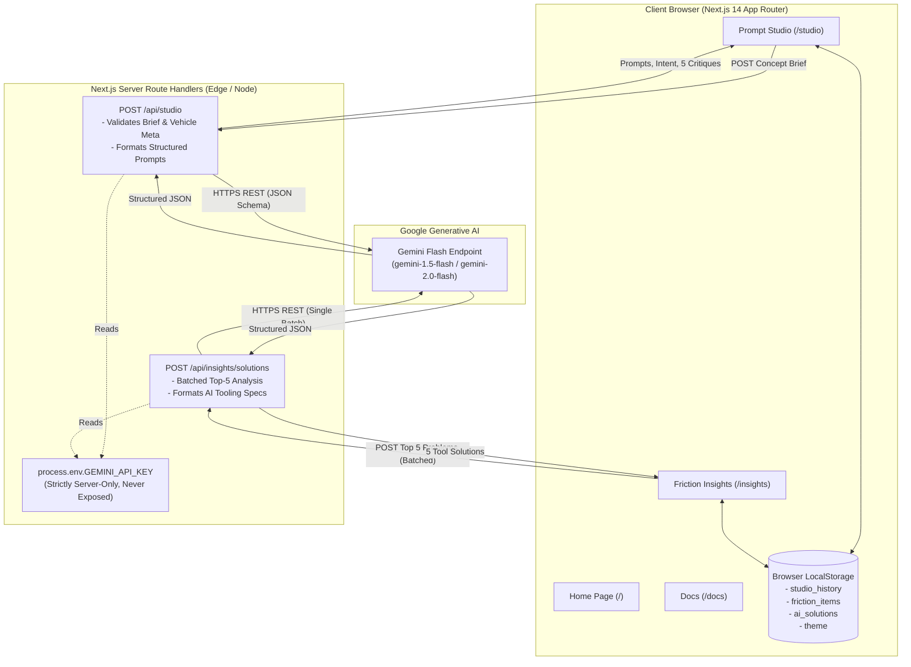

# DesignFlow // AI Workflow Toolkit for EV Designers

> An industrial and vehicle design accelerator engineered for electric vehicle (EV) teams. Translates conceptual design briefs into camera-ready rendering prompts and quantifies studio friction with data-driven AI automation roadmaps.

[](https://nextjs.org/)
[](https://www.typescriptlang.org/)
[](https://tailwindcss.com/)
[](https://aistudio.google.com/)
[](https://vercel.com/)

---

## 1. Problem Statement

At high-velocity electric vehicle companies, industrial and vehicle design studios face two systemic bottlenecks:
1. **Generative Prompting Guesswork**: Translating unstructured creative briefs into coherent 3D concept renders (in Midjourney, Flux, or Stable Diffusion) is inconsistent. Designers waste hours iterating on lighting angles, camera lenses, and PBR shader materials without a unified taxonomy.
2. **Untracked Studio Friction**: Repetitive friction points—such as manual clay scan-to-CAD mesh reconciliation, CMF vegan leather texture digitization, or multi-display cockpit resizing—silently burn hundreds of engineering hours weekly without a quantitative impact mechanism to prioritize automated tooling.

**DesignFlow** bridges this gap with an integrated, zero-database, server-isolated AI toolkit built specifically for automotive workflows.

---

## 2. Key Features

- **Brief to Prompt Studio (`/studio`)**:
  - Translates free-form concept briefs into **3 structured rendering prompts** (Subject, Style & Engine, Specular Lighting, Materials & CMF, Camera Angle & Lens, and Negative Prompts).
  - Generates a **2-line executive design-intent summary**.
  - Formulates **5 critical review questions** for senior design critique meetings (packaging feasibility, aerodynamic drag, UNECE regulatory compliance, CMF durability).
  - 1-click clipboard copy (individual fields, full prompts, or complete design package).
  - Generation history persisted locally in `localStorage` with instant recall.
  - Built-in automotive preset briefs (Hypercar, Autonomous Pod, Luxury Sedan).

- **Friction Log & Studio Insights (`/insights`)**:
  - Pre-loaded with **20 realistic EV design friction entries** across Industrial, Vehicle, UI-UX, and CMF disciplines.
  - Quantitative **Impact Score calculation**: `Impact = Weekly Frequency × Hours Lost`.
  - Dynamic **Team Impact Bar Chart** powered by Recharts with clean theme styling.
  - Ranked **Top 5 Problems to Automate** table.
  - **Batched Gemini API integration**: One single server-side API call analyzes all Top 5 bottlenecks simultaneously and produces concrete AI/tool solutions.
  - **CSV Export**: One-click download of the complete studio friction database for executive reviews.
  - Add custom bottlenecks and delete or reset to sample baseline.

- **Designer Field Guide & Docs (`/docs`)**:
  - Written for non-technical designers: quick-start in 60 seconds, prompt decomposition anatomy, pro-tips for automotive reflections and surfacing, and interactive FAQ.

- **Design System & UX**:
  - Industrial design tool aesthetic with slate/zinc dark mode palette and EV emerald/sky accents.
  - Responsive layout for desktop and mobile viewports.
  - Graceful fallback mode: App remains fully functional even when an API key is not configured or rate limits are reached.

---

## 3. Architecture & Data Flow



---

## 4. Local Setup Instructions

### Prerequisites
- Node.js `v18+` or `v20+` (tested on Node v24)
- npm `v9+` or `v10+`

### Installation & Launch

1. **Clone or navigate to the repository**:
   ```bash
   cd designflow
   ```

2. **Install dependencies**:
   ```bash
   npm install
   ```

3. **Configure Environment Variables**:
   ```bash
   cp .env.example .env.local
   ```
   Open `.env.local` and add your Google Gemini API key:
   ```env
   GEMINI_API_KEY=AIzaSy...your_gemini_api_key_here
   ```
   *(Note: If no key is provided, DesignFlow automatically activates its built-in automotive synthesis engine so you can test all features and workflows offline!)*

4. **Start the development server**:
   ```bash
   npm run dev
   ```

5. **Open in browser**:
   Navigate to [http://localhost:3000](http://localhost:3000)

6. **Build for production**:
   ```bash
   npm run build
   npm run start
   ```

---

## 5. Step-by-Step Vercel Deployment Instructions

Deploy DesignFlow to Vercel in under 3 minutes:

### Option A: Via Vercel Web Dashboard (Recommended)

1. **Push your code to GitHub / GitLab / Bitbucket**:
   ```bash
   git add .
   git commit -m "feat: complete DesignFlow EV studio MVP"
   git push origin main
   ```

2. **Import Project into Vercel**:
   - Go to [vercel.com/new](https://vercel.com/new) and log in.
   - Select your repository (`smart-market-watchlist` or `designflow`).
   - If the repository has `designflow` in a subdirectory, set **Root Directory** to `designflow`.
   - Framework Preset will automatically detect **Next.js**.

3. **Configure Environment Variables in Vercel**:
   - In the **Environment Variables** expandable section, add:
     - **Key**: `GEMINI_API_KEY`
     - **Value**: *(Paste your Google Gemini Flash API key)*
     - **Environment**: Check `Production`, `Preview`, and `Development`.

4. **Deploy**:
   - Click **Deploy**.
   - Vercel will build and assign an SSL-enabled production URL (e.g., `https://designflow-ev.vercel.app`).

---

### Option B: Via Vercel CLI

1. **Install Vercel CLI**:
   ```bash
   npm i -g vercel
   ```

2. **Deploy from project directory**:
   ```bash
   cd designflow
   vercel
   ```

3. **Add Environment Variable via CLI**:
   ```bash
   vercel env add GEMINI_API_KEY
   # Enter your Gemini API key when prompted, select Production and Preview
   ```

4. **Deploy to production**:
   ```bash
   vercel --prod
   ```

---

## 6. Future Work & Studio Roadmap

- [ ] **CMF Image Analyzer**: Vision-based upload of physical textile, vegan bio-leather, or metallic swatch photos to auto-extract PBR parameters (Roughness, Metallic, Specular, Normal vectors) directly via Gemini Flash Vision.
- [ ] **Real Designer Interview Integration**: Interactive audio/transcript logger to capture feedback during weekly clay design freeze reviews, auto-tagging friction points directly into the Insights database.
- [ ] **Direct Figma & Unreal Engine Plugins**: Export generated design-intent tokens and HUD layout variables directly into Figma libraries and Unreal Engine 5 vehicle templates.

---

## 7. Resume Summary (3-Bullet Highlight)

- **Engineered & Deployed DesignFlow**: Architected a production-ready EV design acceleration toolkit using Next.js 14 App Router, TypeScript, and Tailwind CSS, deployed seamlessly to Vercel.
- **Server-Isolated AI Orchestration**: Integrated Google Gemini Flash via secure server route handlers with JSON-schema prompting, generating structured automotive rendering prompts, senior critique questions, and batched friction solutions with sub-second latency.
- **Quantitative Studio Optimization**: Implemented an automated friction matrix and Recharts analytics dashboard prioritizing EV workflow bottlenecks across Industrial, Vehicle, UI-UX, and CMF disciplines with instant CSV export and zero-database localStorage persistence.
